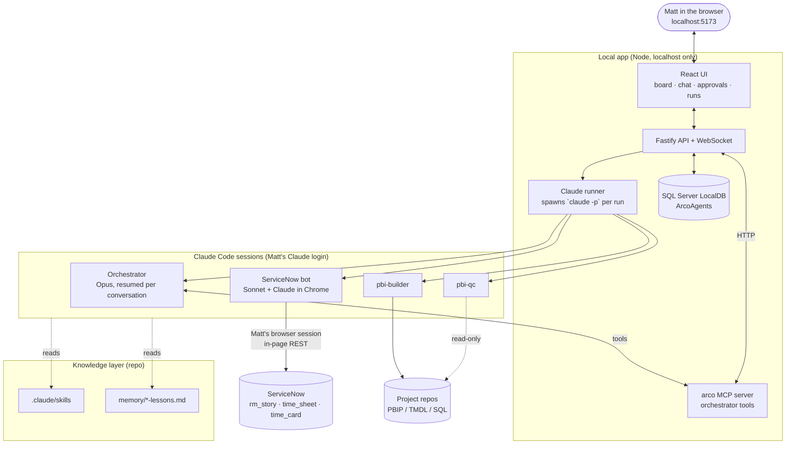
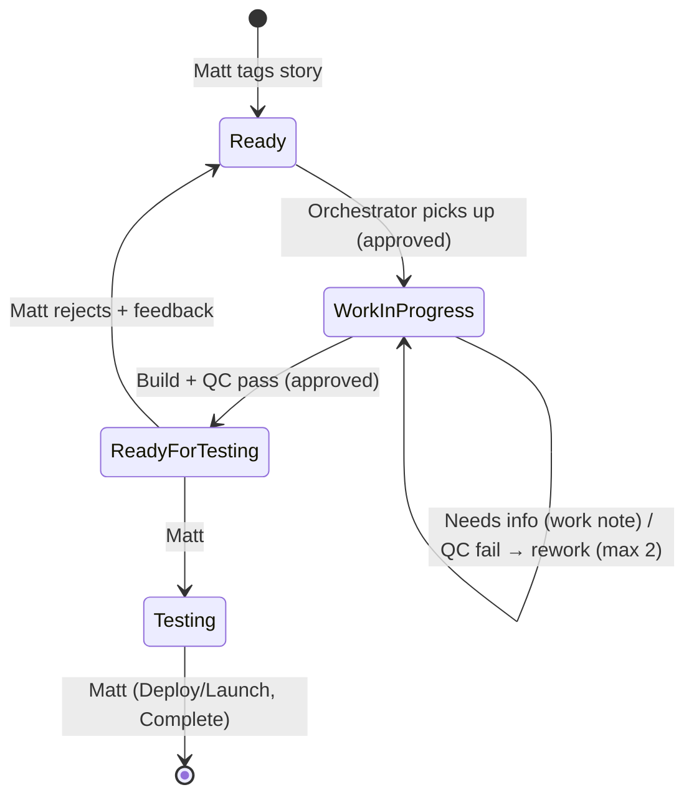
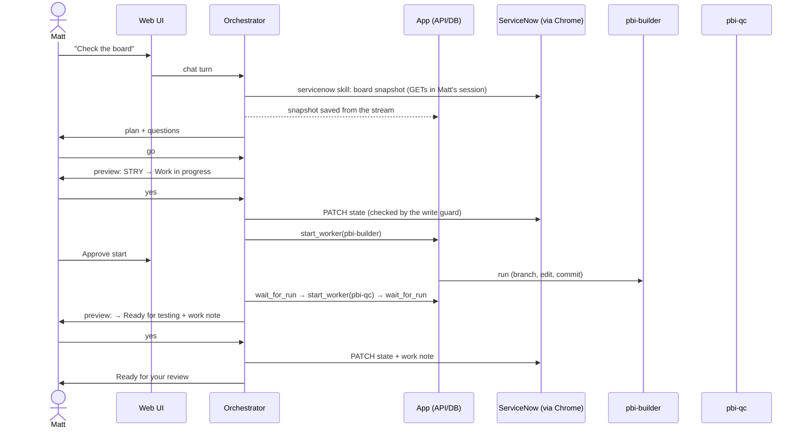

# ARCO BI Agents — Architecture

**Status:** Draft v0.2 · **Owner:** Matt Speaks · **Last updated:** 2026-10-15

> **v0.2 changes from v0.1:** a local web app replaces "the manager runs inside VS Code" (§2). ServiceNow access
> goes through Claude in Chrome on Matt's own session, using the REST API from inside the page, with no integration
> user (§4). The doc's custom lanes are mapped onto the existing VTB lanes (§4.3). Timesheets are added (§4.5).
> State lives in local SQL Server (§7). Open questions 1–2 are answered (§11).

## 1. Purpose

A set of Claude agents takes BI and data warehouse work from the ServiceNow Visual Task Board (VTB) and carries
it out: Power BI build work, QC and data warehouse changes. Matt watches and steers everything from a **local
web app**: what's in flight, what's waiting on him, and a chat with the orchestrator. He reviews and approves the
work at defined checkpoints.

### Goals

- ServiceNow VTB stays the **system of record** for all work.
- One conversational entry point (the **orchestrator**, acting as the Power BI and DWH **Managers**), which sends
  work to specialized **Workers**.
- Every agent action is visible live and recorded (runs, events, approvals) in a local database.
- Workers improve over time from reviewed feedback (**persistent lessons**).
- Every change is reviewable as a git diff before it reaches a shared environment.

### Non-goals (v1)

- Autonomous deployment to production.
- Closing ServiceNow stories without human approval.
- Unattended or scheduled runs. Planned for a later phase (§10).
- Writing time to the timesheet.

---

## 2. High-level design



### How agents run

- Every agent run is the **unmodified `claude` CLI** started headless (`claude -p --output-format stream-json`)
  under Matt's own Claude Code login (ARCO Enterprise). No API key is needed. The app never reads or stores
  credentials. An API key would also turn off the Chrome integration.
- The runner records every stream message (tool calls, results, text) as a `run_event`, saves it to SQL Server
  and pushes it to the UI over a WebSocket.
- The **orchestrator** is a Claude session that resumes for each chat conversation. Its tools come from the
  `arco` MCP server (`server/mcp/arco-mcp.mjs`), which calls the local API. Every orchestrator action therefore
  becomes a tracked record.
- **Workers** are separate runs (`claude -p --agent <name>`), started by the orchestrator's `start_worker` tool.
  They run from this repo, so `.claude/agents`, skills and lessons load, and the target project is attached with
  `--add-dir`. The v0.1 constraint ("subagents can't spawn subagents") goes away: the app is the orchestrator's
  runtime, and every worker is a first-class run.

---

## 3. Components

### 3.1 Orchestrator (managers)

One orchestrator plays both manager roles. Routing hashtags decide which worker set applies.

| Role | Routes tags | Workers it can call |
|---|---|---|
| Power BI Manager | `#PowerBI`, `#Report`, `#SemanticModel` | `pbi-builder`, `pbi-qc` |
| DWH Manager (phase 6) | `#NewTable`, `#DWH`, `#Pipeline` | `dwh-builder`, `dwh-qc` |

**Responsibilities** (prompt: `prompts/orchestrator.md`)

1. Read the board through `list_stories` and `get_story`, and sync when the data is stale.
2. Triage each story: check that it's clear, break it into tasks, and ask Matt when it's ambiguous.
3. Brief workers precisely (story, acceptance criteria, project path, files).
4. **Always** run the matching QC worker after a builder finishes. Allow at most 2 rework loops.
5. Propose lane moves and work notes. These create approval cards.
6. Propose lessons from Matt's feedback. These also create approval cards.

The orchestrator has no Edit, Write or Bash tools, and no direct ServiceNow access.

### 3.2 Workers

| Worker | Mode | Starts | Responsibility |
|---|---|---|---|
| `pbi-qc` | **Read-only** (Read/Grep/Glob) | Immediately | Check PBIP projects against §5.3 and return PASS/FAIL with findings |
| `pbi-builder` | Read/write + scoped git | **After Matt approves** | Edit PBIP on an `agent/<story>-<slug>` branch and commit. No push, merge or deploy |
| `dwh-builder`, `dwh-qc` | — | — | Phase 6 |

Each worker's prompt is in `.claude/agents/<name>.md`. Its tool policy (allowed and denied tools, and whether it
needs approval) is in `config/app.config.json` and is enforced by the runner through `--allowedTools` and
`--disallowedTools`.

### 3.3 Approvals

Approvals are the human checkpoint. ServiceNow changes are approved **in chat**: the orchestrator calls
`request_approval`, which puts an Approve / Reject card (`sn_confirm`) in the **Approvals** panel, with a one-line pointer
in the chat. Clicking it posts Matt's answer ("Yes, go ahead: …" or "No, …") into that chat as his message. **Only the
turn his Approve click starts can write:** the write guard asks `/api/agent/write_permit`, so a typed "yes" doesn't
unlock writes. A newer preview in the same chat replaces older pending cards (§4.1).

**Story chats.** "Discuss with orchestrator" on a story opens that story's own conversation (`conversations.story_number`),
reopened every time. The orchestrator is told the chat is scoped to that story, and workers started there default to it.
The main chat stays for general work: timesheet, board management, new stories. The orchestrator can only *propose* the following; Matt approves or rejects them in the UI,
and only then does the app act:

| Kind | Created by | On approve |
|---|---|---|
| `start_worker` | `start_worker` for a write-capable worker | Worker run starts |
| `lesson` | `propose_lesson` | Appended to `memory/<worker>-lessons.md` |

### 3.4 Skills and lessons

Unchanged from v0.1: `.claude/skills/{powerbi, style-guide, medallion, servicenow}` and
`memory/<worker>-lessons.md`. Workers also pick up the user-level `powerbi-authoring` plugin skills when they're
installed.

---

## 4. ServiceNow integration

### 4.1 Access method

Access goes through **Claude in Chrome on Matt's browser session**, with no integration user or OAuth app. It
follows the same pattern as the team's shared `servicenow-agile-board` skill: **the conversation Matt is typing in
does the work itself.**

- **Where:** the orchestrator chat session uses Claude in Chrome directly, in response to Matt's own messages.
  No background session touches ServiceNow. Sessions with no user present that operate his logged-in browser are
  what Claude Code's safety classifier blocks, and rightly so.
- **How:** the `servicenow` skill (`.claude/skills/servicenow/`) defines a small `window.SN` fetch helper in a
  ServiceNow tab. Each step is then one short, readable REST Table API call, authenticated by the page's session
  token (`g_ck`).
- **Writes:** resolve → preview card in chat → **Matt's explicit "yes"** → re-check `sys_updated_on` → PATCH/POST →
  verify the returned record → **resync**. The `server/hooks/sn-resync-check.mjs` Stop hook won't let a turn that
  changed ServiceNow end until it has re-read the matching snapshot (board for stories, timesheet for hours), so the
  app's local copy always reflects the change.
- **Guard:** `server/hooks/sn-write-guard.mjs` is a PreToolUse hook on `javascript_tool`. It blocks DELETE/PUT,
  writes to tables other than `rm_story`/`time_card`, story states outside `agentAllowedStateValues`, and any change
  to `time_sheet` or a time card's `state`, whatever the model writes.
- **Dashboard copy:** the skill's snapshot recipes return `{ __arco: 'board-v2' | 'timesheet-v2', … }`. The server
  saves those results from the chat's stream into SQL Server. **Sync ServiceNow** in the UI posts a visible request
  from Matt into the "ServiceNow refresh" chat.
- Only one Claude session can hold the Chrome connection on Windows, so orchestrator turns are serialized.
- When the session expires, the orchestrator asks Matt to sign in. It never enters credentials.
- Long term: an integration account or OAuth client would let the app call the API directly.

Instance: `arcoconstruction.service-now.com`. Board: **ABS Data and Analytics: Current Sprint**
(`vtb_board` `423702ce837b0350cc2a47447daad34e`). It's a guided board over **`rm_story`**, laned by `state` and
filtered to the active sprint and the ABS D&A assignment group.

### 4.2 Routing

- **v1:** hashtags in the story's short description or description (`#PowerBI`, `#DWH`, …), parsed at sync time
  into `stories.domain`.
- **Target:** a ServiceNow tag or a custom field, if the hashtags prove noisy.

### 4.3 Story state machine (mapped onto existing VTB lanes)



| v0.1 concept | VTB lane |
|---|---|
| Ready | Ready (+ routing hashtag) |
| Agent In Progress | Work in progress |
| Needs Info | Stays in Work in progress, with a work note |
| Agent Review | Ready for testing |
| Done | Testing / Deploy/Launch / Complete. **Matt only** |

`agentAllowedStateValues` in `config/app.config.json` is the allow-list (2 = Work in progress, -7 = Ready for testing).
The write guard enforces it.

### 4.4 Work note template

```
[Agent: Power BI Manager] Story STRY0012345
Summary:   <what was done>
Changed:   <files / workspace items>
QC result: PASS | FAIL (n findings) — <excerpt>
Branch/PR: <link>
Needs:     <decision or approval required from Matt>
```

### 4.5 Timesheet

`time_sheet` holds one row per user per week (weeks start Sunday). `time_card` holds one row per task per week,
with `sunday`…`saturday`, `total`, `category`, `task` and `top_task`. Sync reads this week and last week, and the
app keeps every week it has read. The Timesheet tab switches between **This week** and **Last week**, and can refresh
either one. Story cards show this week's hours, and the orchestrator can read the timesheet with `get_timesheet`.

The **Timesheet card** (`time_entry`) logs hours for a story. It has a box per day for this week or last week, with
what's already logged on the story shown, and Matt's Add click starts the chat turn that writes them.

The orchestrator reads and changes hours with the `servicenow` skill (`references/writing.md`), previewed on an
approval card (or entered on the Timesheet card) and written only in the turn Matt's click starts. Each entry sets one day's total for one row: a story or task, or a category such
as Admin or Meeting. Guardrails:
- Matt's own timesheet only.
- Pending sheets only.
- Hours go in quarter-hour steps, with no more than 24h in a day.
- Agents never submit the timesheet, and the write guard blocks any change to `time_sheet` or a card's state.

---

## 5. Power BI / Fabric integration

PBIP only, with the QC rule set in `.claude/skills/powerbi/qc-rules.md`. There is no Fabric Git connection. The app
moves reports between Fabric and the PowerBI repo itself, with the Fabric REST API and Matt's `az login`:
- **Pull:** `getDefinition` returns the report (PBIR or PBIR-Legacy) and the model (`?format=TMDL`): the files of a
  PBIP folder.
- **Publish:** Create Item / Update Item Definition take the same parts back. There's no PBIX step.

Verified on *Incidents Report* (Safety): the pulled files read back byte for byte.

### 5.1 Repo layout
- The repo is `config.powerbi.repoPath` (PowerBI, Azure DevOps). The first-level folders mirror workspace names
  (`Accounting/`, `Safety/`).
- A workspace maps to the folder of its name minus any "Acceptance Region" suffix, or to an override in
  `powerbi.workspaceFolders`.
- A report that already exists in that folder is found by its `.platform` display name and updated in place.
  A new one goes in `<Folder>/<Report>/`.
- Agent work happens in a **git worktree per story** (`powerbi.worktreeRoot/<story>`) on
  `agent/<story>-<slug>`, branched from `origin/<default branch>`. Matt's own checkout is never touched.

### 5.2 The story workflow (`server/src/pbi/flow.ts`, state in `dbo.story_flows`)
Everything happens in the **story chat**. Cards appear in that chat and in Approvals.

| # | Step | Who | ServiceNow |
|---|---|---|---|
| 1 | Orchestrator finds the report (`list_fabric_items`), agrees the plan, then calls `propose_report_work` | Orchestrator | |
| 2 | **Start card**: the plan, the pull, the move to WIP, the loop, and the move to Ready for testing on review | **Matt** approves | |
| 3 | Matt's Approve starts a chat turn that moves the story | Orchestrator | → **Work in progress** + work note |
| 4 | Pull into the repo; untouched first commit | App | |
| 5 | builder → QC → builder → QC → builder → final QC. It stops as soon as QC passes, and each pass is a tracked run | App | |
| 6 | **Review report card**: QC verdict, summary, branch | | |
| 7 | **Open** launches the `.pbip` in Power BI Desktop. The first open in each round starts a chat turn that moves the story | **Matt** clicks; orchestrator | → **Ready for testing** + work note |
| 8a | **Not ready**: the story moves back, then the orchestrator interviews Matt until the change list is complete. It calls `submit_revision`, which puts up a **revision card** (the changes + the acceptance-criteria text) | **Matt** answers and approves | → **WIP**, acceptance criteria appended |
| 8b | Revision approved: back to step 5 (round n+1), then step 6 | App | |
| 9a | **Approve** → **final QC**: the app commits what Matt saved in Desktop, and pbi-qc reviews exactly what will be published (the whole branch diff, with Matt's own edits called out), then posts its report with a "What is being published" summary. A FAIL doesn't block publishing | App | |
| 9b | **Publish card**, showing the final QC verdict and report, with three fields. **Workspace:** every workspace you can access, with one marked *suggested* (the story's own source workspace, or its "Acceptance Region" sibling); TEST/PROD/UAT ones are listed but can't be picked. **Report:** update an existing report in that workspace (matched by item id: the story's own report is pre-selected), or create a new one. **Name:** editable; the report gets this name in Fabric *and* in the repo (folder, .pbip, display name, renamed with git mv before the PR) | **Matt** picks and confirms | |
| 10 | Rename in the repo if the name changed. Publish the model (the one the chosen report is bound to, or one with the model's name, or a new one), then the report, re-pointed (`byConnection`) at that model; renamed in Fabric if needed. Push the branch, open the Azure DevOps PR | App | stays in Ready for testing |
| 11 | **Timesheet card**: this week's days, each with a box for hours to add (what's already logged on the story is shown). **Add** starts a chat turn that adds them | **Matt** fills it in | time_card hours |
| 12 | Merge the PR, set credentials/refresh a new model, update the app | **Matt** | Testing onward is Matt's |

Each ServiceNow move happens in a turn started by one of Matt's own clicks (Approve or Open), and only the turn
that click starts can write: `write_permit` checks the card. The app never touches ServiceNow itself, and nothing
in the flow starts a chat turn on its own. Its progress notes are plain chat messages.

### 5.3 When work isn't linear
One workflow per story. It owns the story's branch, and it can change course at any point (flow.ts):
- **Start from the repo or from Fabric.** `propose_report_work` takes `repo_report` (build on main as it is) or a
  workspace + report (pull first). A pull lands in the existing repo folder: the one the orchestrator names, or one
  whose `.platform` display name matches. A new folder is made only when neither exists.
- **Take over outside work.** `attach_report_work` puts a branch built outside the workflow into the app's worktree.
  If Matt has that branch checked out, he switches his checkout away first; agents never work in his checkout.
- **Review card on demand.** `request_review` raises one for the branch as it is, so a finished build always ends in one.
- **Rebuild from any stage.** `submit_revision` works after Not ready, a stop, a failure or publishing. The
  acceptance-criteria text is optional.
- **Stop.** `stop_report_work` cancels the running worker, and the branch keeps what was committed. Publishing
  can't be stopped halfway.
- **Builds can't go around it.** `start_worker` refuses `pbi-builder` on the PowerBI repo, so every build runs in
  the workflow and ends in a Review card.
- **Cards follow the branch.** A new build, attach or review supersedes older pending Review and Publish cards. The
  Review card authorises its own lane moves: Open → Ready for testing, Not ready → WIP.
- **QC gets the diff from the app,** as `git diff --stat <base> HEAD` and the list of changed files. The base is the
  untouched pull commit, or the point where the branch left main.

If the server restarts in the middle of a step, the flow is marked failed. The orchestrator can rerun it with a
rebuild card.

### 5.3a House playbook and linter (`.claude/skills/arco-dwh-powerbi`, `server/src/pbi/lint.ts`)
- The builder and QC follow the ABS Data & Analytics house playbook (`arco-dwh-powerbi`, vendored unmodified; see
  its `VENDORED.md`). `.claude/skills/powerbi/SKILL.md` says how it applies to app agents, and where the app's rules
  win: no publishing, no Desktop or screenshots, no DWH queries, repo worktrees instead of `C:\SNOW Logic`.
- After every builder pass, and in the final QC, the app runs the playbook's `check_pbir.py` (read-only, about 2 s,
  including Desktop's own TMDL parser) twice: on the branch, and on its starting point (exported with
  `git archive`, following a renamed report). Only findings the branch introduced count. **Any new ERROR fails QC**,
  whatever the QC run says, and goes back to the builder. The Review card shows the linter result, and the full
  findings go in the QC report.
- The builder may run the linter itself before committing (`Bash(py …check_pbir.py:*)`).

### 5.3b Data gaps → new stories (`server/src/dwh/catalog.ts`, `server/scripts/dwh_catalog.py`)
- **Catalog.** The app keeps a read-only catalog of every gold and silver table, view and column in
  `data/catalog/{gold,silver}.tsv`. It's built by one fixed `INFORMATION_SCHEMA` query with Matt's `az` identity, takes
  about 12 s per database, and is rebuilt when more than a day old (before a build loop, or via
  `POST /api/catalog/refresh`). Agents never get a SQL connection: Matt can write to gold and silver, so the script takes no SQL
  input.
- **The builder checks everything the work needs.** It compares against the model TMDL and the gold catalog, and ends
  its result with a `data-gaps` JSON block listing every gap at its level:
  - `missing_table`: not in gold;
  - `missing_column`: on an existing gold table;
  - `not_in_model`: in gold, not in the semantic model;
  - `unknown`: couldn't confirm.

  Each gap carries what needs it, a source hint (often from the silver catalog) and whether it's blocking.
- **Derivable isn't a gap.** Anything computable from existing data (DAX, a calculated column, an existing join) is
  listed as `derivable`, with its derivation, and built. It never goes in a story and never blocks. Every real gap
  says what was searched (`checked`).
- **Blocking gaps stop the loop.** The builder takes its data inventory first, and if a blocking gap exists it doesn't
  build the dependent parts. The app halts right after that builder pass: no QC, no further passes, no Review card
  (stage `gaps`). Then:
  1. The **Data gaps** card offers **one** story, "Data Gaps for - STRY… - &lt;short description&gt;", covering every real
     gap, in the **current sprint or the backlog**. **Create** starts the orchestrator turn that drafts it onto an
     approval card.
  2. Then the **Proceed or pause** card. **Proceed** builds everything that doesn't depend on the gaps, then QC and
     Review as usual. **Pause** leaves the flow idle; the next rebuild checks the data again.
- **Non-blocking gaps don't stop the build.** The Data gaps card still offers the story, ahead of the Review card.

### 5.3c Report model builder (`.claude/agents/pbi-report-model-builder.md`, `modelStep` in flow.ts)
- **Model first.** Every round starts with `pbi-report-model-builder`, scoped to the one report's own semantic model.
  It never touches shared Gold models, the ontology or the DWH. It reads:
  - **ARCO_Gold_Ontology**, a read-only copy in `data/ontology/` refreshed daily via `getDefinition`: 95 entities
    mapped to gold tables, declared relationships, and descriptions with grain, join quality, TRAPS and sensitivity;
  - the **catalogs** (gold, silver and source bronze; `bronze_confidential` is excluded);
  - the report and its model.
- **How it resolves what the report needs.** It takes an inventory, maps name confusion, derives what it can (DAX,
  calculated columns, declared joins), and adds gold tables or columns to the model. What's left are real gaps
  (`missing_table` / `missing_column`), each with **proposed sources**: silver first, then source bronze, with the
  join and why.
- **Model QC when the model changed.** pbi-qc checks it against QC-17 (ontology joins, grain, traps, sensitivity)
  plus the model rules, with one fix pass.
- **Blocking gaps stop the round.** The Data gaps card (one story) comes first, then the **Proceed-or-pause** card:
  - **Pause.**
  - **Proceed with these sources:** exactly the proposed sources are wired in, each table annotated
    `ARCO_TemporarySource` with the approval date and the story. QC-01 passes those with a note; any other silver or
    bronze source still fails.
  - **Proceed without:** what's left out is listed, not faked.
- **Handoff.** The model builder's `## Model handoff` goes into the report builder's brief, and the report builder
  doesn't change the model's tables, sources or relationships.
- **Handback.** If the report builder finds the model missing something, or wrong, it ends its pass with a
  `model-requests` block (measure / table / column / relationship / fix). The app runs the model step again with those
  requests (model QC included), then repeats that builder pass on the updated model. That can happen at most twice per
  round.
- **The `arco-ontology` skill** (`.claude/skills/arco-ontology`) teaches the bots to read the ontology copy:
  - entity → `backingTable` → the table's `schemaName`. Gold has many schemas: `analytics`, `servicenow_analytics`,
    `greenhouse_analytics`, `ukg_analytics` and more;
  - declared joins only;
  - traps, sensitivity;
  - the name-confusion procedure.

### 5.3d Data Gaps stories: the gap designer (`.claude/agents/dwh-gap-designer.md`, `pbi/gapdesign.ts`)
- In a "Data Gaps for - STRY…" story's chat, `start_gap_design` runs **dwh-gap-designer**. It's read-only (Read,
  Grep, Glob, Skill) and uses the ontology skill, the catalogs, and the DWH repo's gold SQL as patterns.
- **Its output is text only, for human review.** Nothing is written to the DWH, no SQL files, no objects. Per gap it
  gives one of:
  - **name confusion:** the mapping plus its evidence;
  - **derivable**;
  - a **gold column addition:** target table, column, source silver table and column, join, why;
  - a **new gold table:** schema per the ontology, grain, key, columns with sources, joins, why;
  - a **new silver table**, only if needed;
  - **still unknown.**
- **The design comes back as a card** in the gaps story chat. **Approve design** starts the turn that adds it to the
  story as a work note, and sends the approved **name mappings** to the original report's story. There they're stored
  on its flow (`approvedMappings`) and given to the report model builder on the next rebuild.
- **Declining with a comment** sends the comment into the chat as Matt's message. The orchestrator answers his
  questions, proposes one `arco-data` lesson per fact he stated, and reruns the designer. The rerun's brief carries
  the declined design and his feedback, marked authoritative. Declining with no comment just leaves a note.
- Comments on other declined cards (data-gaps story, Pause, Close story, Timesheet) also reach the chat, so a note is
  never silently dropped. If the chat is busy, the comment shows as an app note.

### 5.3f Read-only data checks: `dwh_query` (`dwh/query.ts`, `scripts/dwh_query.py`, `mcp/worker-mcp.mjs`)
- **Who gets it.** Workers with `dwhQuery: true` in their policy, today the report model builder and the gap
  designer. They get one MCP tool, `dwh_query`, and never a connection. The workspace SQL address isn't read-only:
  it's shared by every warehouse, and Matt's identity can INSERT, ALTER and CREATE VIEW on gold and silver. So:
- **The app checks every query** (`checkQuery`):
  - one SELECT or WITH statement; no write, DDL, EXEC or session keywords; no `;` chains; no `SELECT *`;
  - only the catalog databases; `dwh.query.blockedDatabases` (bronze_confidential, gold_uat, arco_meta_dw,
    staging) are refused, including through three-part names;
  - columns the ontology flags sensitive (55 today), and `blockedColumnPatterns` (pay and personal data), may
    appear in a SELECT list only inside COUNT(...). Joins, filters and GROUP BY on them are fine.
- **The Python runner checks again**, then runs the statement inside a transaction that is always rolled back.
- **Limits:** 50 rows, values cut at 200 characters, a 60-second timeout, and 40 queries per run.
- **Logging and tests.** Each call, with its stated purpose and result, shows in the run log. The gate's regression
  test is `npm run test:query` (add `-- --live` for real read-only queries).
- **Later:** a reader-only identity (gold and silver reader roles, no workspace role) would make the database itself
  refuse writes. Swapping the runner to it would be a config change.

### 5.3e Shared reference copies the data bots read
- **Gold semantic models** (`dwh/goldModels.ts`): a read-only TMDL copy of every `^Gold ` model in the ARCO DWH
  workspace, in `data/gold-models/<model>/`, fetched with getDefinition and refreshed daily. It shows what each model
  already exposes. `npx tsx server/scripts/fetch-gold-models.ts` refreshes it now.
- **ARCO data facts** (`memory/arco-data-lessons.md`): lessons Matt approved with worker `arco-data`, such as name
  mappings and retired sources. Every data bot reads the file first, and it overrides their findings and the ontology.

### 5.4 Close-out (`server/src/closeout.ts`, `dbo.story_checklists`)
Publishing isn't the end of a story. Matt's rollout steps are, and the app keeps track of them:
- **Close-out card.** After a publish, the story chat gets Matt's checklist. The default is in
  `config.closeoutChecklist`: app published for business review, PRs completed, published to production, final
  adjustments and sign-off. It's his list. He ticks items, adds notes, and adds or removes items for the story. The
  app ticks an item only when it can prove it: "PRs completed" ticks when the story's PR shows completed in Azure
  DevOps (a read-only check). The card is also in the story panel, and `start_closeout` or the panel starts it for
  stories that weren't published through the workflow.
- **The story stays open until every item is ticked.** Until then the chat list and the board card show
  "close-out n/m".
- **Close story card.** When all items are ticked, Matt's Close story… opens a card covering:
  1. a final work note, which lists the checklist with dates, the published report and the PR (the lane isn't
     touched: Complete is Matt's);
  2. a last Timesheet card;
  3. removal of the agent's worktree and local branch, if the PR is completed;
  4. archiving the chat.
- **Archive.** Any chat can be archived or reopened from the chat header. Archived chats sit in their own group in
  the chat list. Nothing is deleted, and writing in an archived chat reopens it.

---

## 6. Learning loop

Unchanged in substance. Feedback goes to `propose_lesson`, which creates an approval card. On approval the lesson
is appended to `memory/<worker>-lessons.md` with the next `L-PBI-###` code, workers read it at the start of each
task, and stable lessons are promoted into a skill. Lessons files stay under ~150 lines.

---

## 7. Repository layout

```
arco-matt-agents/
├── ARCHITECTURE.md · README.md · CLAUDE.md
├── config/app.config.json          # instance, board, lanes, routing, worker tool policies, models
├── prompts/orchestrator.md         # orchestrator role prompt
├── .claude/
│   ├── agents/                     # pbi-builder.md, pbi-qc.md (dwh-* in phase 6)
│   └── skills/                     # powerbi/ (+qc-rules.md), style-guide/, medallion/, servicenow/
├── memory/                         # <worker>-lessons.md
├── server/                         # Node + TypeScript
│   ├── src/index.ts                # HTTP API + WebSocket (127.0.0.1 only, origin-checked)
│   ├── src/claude/runner.ts        # spawns `claude -p`, records stream events
│   ├── src/orchestrator.ts         # chat → resumed orchestrator session
│   ├── src/workers.ts              # worker registry, approval gating, worker runs
│   ├── src/approvals.ts · lessons.ts · runs.ts
│   ├── src/servicenow/             # chrome.ts (Chrome mutex, snapshot capture), store.ts; hooks/sn-write-guard.mjs
│   ├── src/db/                     # SQL Server (msnodesqlv8/ODBC), idempotent schema
│   └── mcp/arco-mcp.mjs            # orchestrator tools → local API
├── web/                            # React + Vite UI
└── data/                           # gitignored: temp files, logs
```

**Database** (`ArcoAgents` on `(localdb)\MSSQLLocalDB`, Windows auth): `stories`, `lanes`, `timesheets`,
`time_cards`, `runs`, `run_events`, `conversations`, `chat_messages`, `approvals`, `lessons`. The schema is
applied idempotently at startup.

---

## 8. End-to-end flow (example)



---

## 9. Guardrails

| Area | Control |
|---|---|
| Production | Reports reach production workspaces only through a Publish card Matt approves. A workspace that doesn't match `powerbi.nonProductionWorkspacePatterns` counts as production, and needs his extra confirmation on the card (the server checks it). Agents never publish or update Power BI apps (Matt does) |
| ServiceNow | Done only in the chat Matt is typing in, never by background sessions. Every write is previewed and needs Matt's "yes". The write guard hook blocks other lanes, deletes, other tables, and timesheet submission. New stories (`references/creating.md`) may start only in Backlog, Draft or Ready (`agentCreateStateValues`), and are created in a call of their own. Story edits (title, description, criteria, points, priority, assignee, sprint, epic) go through the same card; a story's `assignment_group` can only ever be the team's group |
| Git | Builders commit to `agent/*` branches only (in a per-story worktree); push, merge, reset and rebase are denied to them. The app pushes the branch and opens a PR only after Matt confirms the Publish card. Nothing ever merges; Matt does |
| Fabric | The app publishes only after Matt picks the workspace on the Publish card, and only to workspaces he can access. Names matching `powerbi.blockedWorkspacePatterns` (TEST, PROD, Production, UAT) are refused. Apps are never published or updated |
| QC | The orchestrator must run QC after every builder run before proposing review |
| Rework | At most 2 build → QC loops, then escalate to Matt |
| Local API | Bound to 127.0.0.1; browser requests from other origins are rejected (403) |
| Secrets | None in the repo. Auth is Windows (SQL) and Matt's Claude Code login. `.env` is gitignored |
| Audit | Every run, tool call, approval and decision is recorded in SQL Server, plus git history and work notes |

---

## 10. Rollout plan

| Phase | Scope | Status / exit criteria |
|---|---|---|
| **0 — Foundation** | Repo, app skeleton, DB, skills skeleton | ✅ Done 2026-10-15 |
| **1 — QC first** | `pbi-qc` run by hand on existing PBIP projects | Finds real issues; acceptable false-positive rate |
| **2 — Orchestrator (read-only)** | Board sync + triage in chat | ✅ Sync and chat working. Exit: correct triage on 10+ stories |
| **3 — Write-back** | Approved lane moves and work notes | Built; first live write pending Matt's test |
| **4 — Builder** | `pbi-builder` with QC required | ≤1 rework loop on average |
| **5 — Learning loop** | Lesson capture and promotion | Repeat feedback trends to zero |
| **6 — DWH domain** | `dwh-builder`, `dwh-qc` | Same as phases 1–4 |
| **7 — Scheduled runs** | Morning triage without a manual start | Summary waiting in the UI each morning |

---

## 11. Open questions

1. ~~ServiceNow API access~~: **Resolved.** Matt's browser session plus the in-page REST API. Table: `rm_story`.
2. ~~Routing field~~: **Hashtags for v1**; revisit if they're noisy.
3. **Fabric topology:** workspace IDs for DEV/TEST/PROD; is Fabric Git integration enabled?
4. **Service principal:** who provisions it, and is "Service principals can use Fabric APIs" enabled?
5. **Style guide:** what's the source of truth (PDF, theme JSON, template .pbit)?
6. **BPA rules:** start from the Microsoft standard rules or an existing ARCO set? Install Tabular Editor CLI?
7. **DWH platform details:** Fabric Warehouse vs. Lakehouse SQL endpoint; naming standards per layer.
8. **New:** which PBIP projects (paths under `C:\Users\mspeaks\source\repos`) should phase 1 QC start with?
