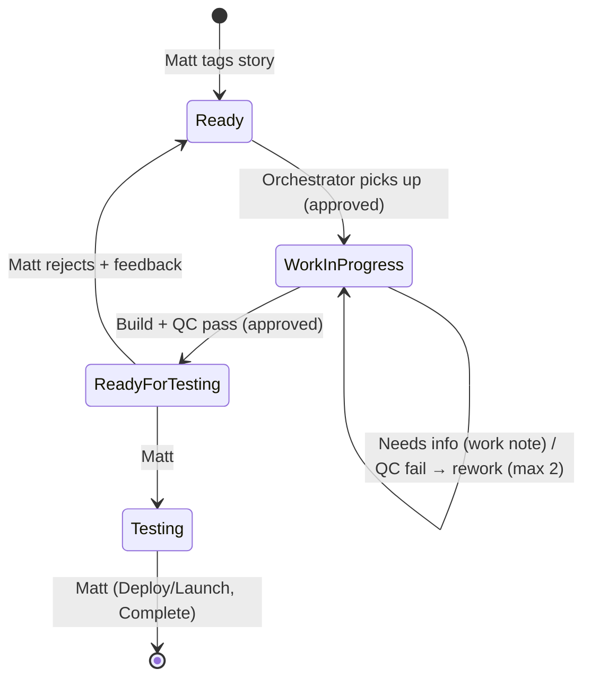
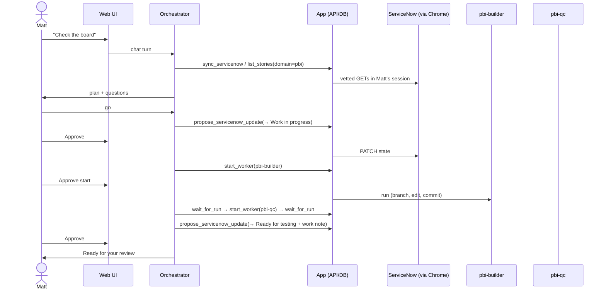

# ARCO BI Agents — Architecture

**Status:** Draft v0.2 · **Owner:** Matt Speaks · **Last updated:** 2026-10-15

> **v0.2 changes from v0.1:** a local web app replaces "the manager runs inside VS Code" (§2). ServiceNow access
> goes through Claude in Chrome on Matt's own session, using the REST API from inside the page, with no integration
> user (§4). The doc's custom lanes are mapped onto the existing VTB lanes (§4.3). Timesheets are added (§4.5).
> State lives in local SQL Server (§7). Open questions 1–2 are answered (§11).

## 1. Purpose

A set of Claude agents takes BI and data warehouse work from the ServiceNow Visual Task Board (VTB) and carries
it out: Power BI build work, QC and data warehouse changes. Matt watches and steers everything from a **local
web app**: what's in flight, what's waiting on him, and a chat with the orchestrator. He reviews and approves the
work at defined checkpoints.

### Goals

- ServiceNow VTB stays the **system of record** for all work.
- One conversational entry point (the **orchestrator**, acting as the Power BI and DWH **Managers**), which sends
  work to specialized **Workers**.
- Every agent action is visible live and recorded (runs, events, approvals) in a local database.
- Workers improve over time from reviewed feedback (**persistent lessons**).
- Every change is reviewable as a git diff before it reaches a shared environment.

### Non-goals (v1)

- Autonomous deployment to production.
- Closing ServiceNow stories without human approval.
- Unattended or scheduled runs. Planned for a later phase (§10).
- Writing time to the timesheet.

---

## 2. High-level design


### How agents run

- Every agent run is the **unmodified `claude` CLI** started headless (`claude -p --output-format stream-json`)
  under Matt's own Claude Code login (ARCO Enterprise). No API key is needed. The app never reads or stores
  credentials. An API key would also turn off the Chrome integration.
- The runner records every stream message (tool calls, results, text) as a `run_event`, saves it to SQL Server
  and pushes it to the UI over a WebSocket.
- The **orchestrator** is a Claude session that resumes for each chat conversation. Its tools come from the
  `arco` MCP server (`server/mcp/arco-mcp.mjs`), which calls the local API. Every orchestrator action therefore
  becomes a tracked record.
- **Workers** are separate runs (`claude -p --agent <name>`), started by the orchestrator's `start_worker` tool.
  They run from this repo, so `.claude/agents`, skills and lessons load, and the target project is attached with
  `--add-dir`. The v0.1 constraint ("subagents can't spawn subagents") goes away: the app is the orchestrator's
  runtime, and every worker is a first-class run.

---

## 3. Components

### 3.1 Orchestrator (managers)

One orchestrator plays both manager roles. Routing hashtags decide which worker set applies.

| Role | Routes tags | Workers it can call |
|---|---|---|
| Power BI Manager | `#PowerBI`, `#Report`, `#SemanticModel` | `pbi-builder`, `pbi-qc` |
| DWH Manager (phase 6) | `#NewTable`, `#DWH`, `#Pipeline` | `dwh-builder`, `dwh-qc` |

**Responsibilities** (prompt: `prompts/orchestrator.md`)

1. Read the board through `list_stories` and `get_story`, and sync when the data is stale.
2. Triage each story: check that it's clear, break it into tasks, and ask Matt when it's ambiguous.
3. Brief workers precisely (story, acceptance criteria, project path, files).
4. **Always** run the matching QC worker after a builder finishes. Allow at most 2 rework loops.
5. Propose lane moves and work notes. These create approval cards.
6. Propose lessons from Matt's feedback. These also create approval cards.

The orchestrator has no Edit, Write or Bash tools, and no direct ServiceNow access.

### 3.2 Workers

| Worker | Mode | Starts | Responsibility |
|---|---|---|---|
| `pbi-qc` | **Read-only** (Read/Grep/Glob) | Immediately | Check PBIP projects against §5.3 and return PASS/FAIL with findings |
| `pbi-builder` | Read/write + scoped git | **After Matt approves** | Edit PBIP on an `agent/<story>-<slug>` branch and commit. No push, merge or deploy |
| `dwh-builder`, `dwh-qc` | — | — | Phase 6 |

Each worker's prompt is in `.claude/agents/<name>.md`. Its tool policy (allowed and denied tools, and whether it
needs approval) is in `config/app.config.json` and is enforced by the runner through `--allowedTools` and
`--disallowedTools`.

### 3.3 Approvals

Approvals are the human checkpoint. The orchestrator can only *propose* the following; Matt approves or rejects in
the UI, and only then does the app act:

| Kind | Created by | On approve |
|---|---|---|
| `start_worker` | `start_worker` for a write-capable worker | Worker run starts |
| `sn_write` | `propose_servicenow_update` | Vetted PATCH runs in the browser session (state and/or work note) |
| `lesson` | `propose_lesson` | Appended to `memory/<worker>-lessons.md` |

### 3.4 Skills and lessons

Unchanged from v0.1: `.claude/skills/{powerbi, style-guide, medallion, servicenow}` and
`memory/<worker>-lessons.md`. Workers also pick up the user-level `powerbi-authoring` plugin skills when they're
installed.

---

## 4. ServiceNow integration

### 4.1 Access method

Access goes through **Claude in Chrome on Matt's browser session**, with no integration user or OAuth app. A
headless Claude session (`claude -p --chrome`) opens the instance in Matt's Chrome and runs **one vetted
JavaScript snippet** (`server/src/servicenow/snippets.ts`). The snippet calls the **REST Table API from inside
the page**, using the session token (`X-UserToken: g_ck`). The results are JSON, not screen-scraped HTML, so a UI
change doesn't break the integration.

- Agents never write their own ServiceNow requests. Reads are fixed GETs, and writes are a single PATCH of
  `state` and `work_notes` on `rm_story`, built only from an approved request.
- The payload is read straight from the tool result in the stream, so the model never re-types data.
- **Extension constraints we work around:** results are capped at 50 KB (we chunk them), each string is capped at
  1000 chars (we split chunks into pieces), and text that looks like cookies or query strings is blanked (we
  escape `= & ; ?` as JSON `\uXXXX`).
- Only one Claude session can hold the Chrome connection on Windows, so browser jobs are serialized and everything
  else reads the local copy in SQL Server.
- If the session expires, the bot reports `LOGIN_REQUIRED` and Matt logs in again in Chrome.

Instance: `arcoconstruction.service-now.com`. Board: **ABS Data and Analytics: Current Sprint**
(`vtb_board` `423702ce837b0350cc2a47447daad34e`). It's a guided board over **`rm_story`**, laned by `state` and
filtered to the active sprint and the ABS D&A assignment group.

### 4.2 Routing

- **v1:** hashtags in the story's short description or description (`#PowerBI`, `#DWH`, …), parsed at sync time
  into `stories.domain`.
- **Target:** a ServiceNow tag or a custom field, if the hashtags prove noisy.

### 4.3 Story state machine (mapped onto existing VTB lanes)



| v0.1 concept | VTB lane |
|---|---|
| Ready | Ready (+ routing hashtag) |
| Agent In Progress | Work in progress |
| Needs Info | Stays in Work in progress, with a work note |
| Agent Review | Ready for testing |
| Done | Testing / Deploy/Launch / Complete. **Matt only** |

`agentAllowedTargetStates` in `config/app.config.json` is the allow-list, checked when a proposal is made and
again when it executes.

### 4.4 Work note template

```
[Agent: Power BI Manager] Story STRY0012345
Summary:   <what was done>
Changed:   <files / workspace items>
QC result: PASS | FAIL (n findings) — <excerpt>
Branch/PR: <link>
Needs:     <decision or approval required from Matt>
```

### 4.5 Timesheet

`time_sheet` holds one row per user per week (weeks start Sunday). `time_card` holds one row per task per week,
with `sunday`…`saturday`, `total`, `category`, `task` and `top_task`. The sync pulls the current week. The UI
shows it and puts each story's hours next to its card, and the orchestrator can read it with `get_timesheet`.

The orchestrator writes time with `propose_timesheet_entry`, which creates a `timesheet_write` approval card. Each
entry sets one day's total for one row: a story or task, or a category such as Admin or Meeting. Because it sets a
value rather than adding one, retrying can't log the same hours twice. When Matt approves, `timeEntrySnippet`
updates the matching `time_card` or creates one, and the local copy is updated to match. Guardrails:
- Matt's own timesheet only, and only for the current or previous week.
- Pending sheets and cards only.
- Hours go in quarter-hour steps, with no more than 24h in a day.
- Agents never submit the timesheet.

---

## 5. Power BI / Fabric integration

Unchanged from v0.1: PBIP only (§5.1), with DEV/TEST/PROD access as in the table below (§5.2), and the QC rule set
in `.claude/skills/powerbi/qc-rules.md` (§5.3). In this phase the builder works on git only; Fabric DEV publishing
arrives with the service principal (open question 4).

| Environment | Agent access | Promotion |
|---|---|---|
| DEV workspace | Builder: read/write via service principal (pending) | Fabric Git integration or API publish |
| TEST workspace | QC: read-only | Deployment pipeline, **triggered by Matt** |
| PROD workspace | None | Deployment pipeline, **triggered by Matt** |

---

## 6. Learning loop

Unchanged in substance. Feedback goes to `propose_lesson`, which creates an approval card. On approval the lesson
is appended to `memory/<worker>-lessons.md` with the next `L-PBI-###` code, workers read it at the start of each
task, and stable lessons are promoted into a skill. Lessons files stay under ~150 lines.

---

## 7. Repository layout

```
arco-matt-agents/
├── ARCHITECTURE.md · README.md · CLAUDE.md
├── config/app.config.json          # instance, board, lanes, routing, worker tool policies, models
├── prompts/orchestrator.md         # orchestrator role prompt
├── .claude/
│   ├── agents/                     # pbi-builder.md, pbi-qc.md (dwh-* in phase 6)
│   └── skills/                     # powerbi/ (+qc-rules.md), style-guide/, medallion/, servicenow/
├── memory/                         # <worker>-lessons.md
├── server/                         # Node + TypeScript
│   ├── src/index.ts                # HTTP API + WebSocket (127.0.0.1 only, origin-checked)
│   ├── src/claude/runner.ts        # spawns `claude -p`, records stream events
│   ├── src/orchestrator.ts         # chat → resumed orchestrator session
│   ├── src/workers.ts              # worker registry, approval gating, worker runs
│   ├── src/approvals.ts · lessons.ts · runs.ts
│   ├── src/servicenow/             # snippets (vetted JS), chrome.ts (browser jobs), sync.ts, store.ts
│   ├── src/db/                     # SQL Server (msnodesqlv8/ODBC), idempotent schema
│   └── mcp/arco-mcp.mjs            # orchestrator tools → local API
├── web/                            # React + Vite UI
└── data/                           # gitignored: temp files, logs
```

**Database** (`ArcoAgents` on `(localdb)\MSSQLLocalDB`, Windows auth): `stories`, `lanes`, `timesheets`,
`time_cards`, `runs`, `run_events`, `conversations`, `chat_messages`, `approvals`, `lessons`. The schema is
applied idempotently at startup.

---

## 8. End-to-end flow (example)



---

## 9. Guardrails

| Area | Control |
|---|---|
| Production | No PROD credentials; never publish or update Power BI apps (Matt does) |
| ServiceNow | Agents only propose. Writes are limited to `state` (allow-listed lanes) and `work_notes`, through vetted snippets, after Matt approves |
| Git | Builder commits to `agent/*` branches only; push, merge, reset and rebase are denied; Matt merges |
| QC | The orchestrator must run QC after every builder run before proposing review |
| Rework | At most 2 build → QC loops, then escalate to Matt |
| Local API | Bound to 127.0.0.1; browser requests from other origins are rejected (403) |
| Secrets | None in the repo. Auth is Windows (SQL) and Matt's Claude Code login. `.env` is gitignored |
| Audit | Every run, tool call, approval and decision is recorded in SQL Server, plus git history and work notes |

---

## 10. Rollout plan

| Phase | Scope | Status / exit criteria |
|---|---|---|
| **0 — Foundation** | Repo, app skeleton, DB, skills skeleton | ✅ Done 2026-10-15 |
| **1 — QC first** | `pbi-qc` run by hand on existing PBIP projects | Finds real issues; acceptable false-positive rate |
| **2 — Orchestrator (read-only)** | Board sync + triage in chat | ✅ Sync and chat working. Exit: correct triage on 10+ stories |
| **3 — Write-back** | Approved lane moves and work notes | Built; first live write pending Matt's test |
| **4 — Builder** | `pbi-builder` with QC required | ≤1 rework loop on average |
| **5 — Learning loop** | Lesson capture and promotion | Repeat feedback trends to zero |
| **6 — DWH domain** | `dwh-builder`, `dwh-qc` | Same as phases 1–4 |
| **7 — Scheduled runs** | Morning triage without a manual start | Summary waiting in the UI each morning |

---

## 11. Open questions

1. ~~ServiceNow API access~~: **Resolved.** Matt's browser session plus the in-page REST API. Table: `rm_story`.
2. ~~Routing field~~: **Hashtags for v1**; revisit if they're noisy.
3. **Fabric topology:** workspace IDs for DEV/TEST/PROD; is Fabric Git integration enabled?
4. **Service principal:** who provisions it, and is "Service principals can use Fabric APIs" enabled?
5. **Style guide:** what's the source of truth (PDF, theme JSON, template .pbit)?
6. **BPA rules:** start from the Microsoft standard rules or an existing ARCO set? Install Tabular Editor CLI?
7. **DWH platform details:** Fabric Warehouse vs. Lakehouse SQL endpoint; naming standards per layer.
8. **New:** which PBIP projects (paths under `C:\Users\mspeaks\source\repos`) should phase 1 QC start with?
